# Riona

**Office management for an Indian IT services firm, built on one idea: an hour of work is recorded once.**
A single timesheet entry becomes the employee's payroll cost, the client's invoice line and the project's margin,
and every one of those figures links back to the hours behind it.

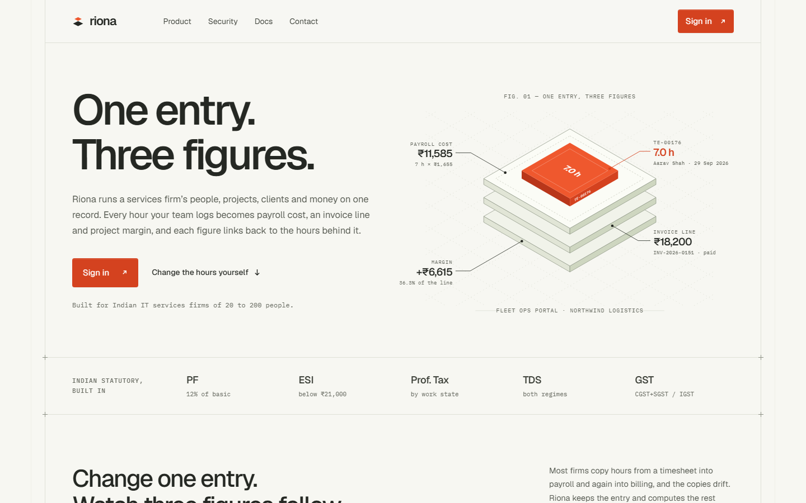

Riona covers people, projects, clients, finance and office operations: twenty-nine modules across five roles
(Admin, HR, Manager, Employee and Client), in one React app backed by Fastify and PostgreSQL. It is a B.Tech
project (2026–27) built to be launched to firms afterwards. Everything you see runs on **Kestrel Digital**, a demo
organisation of 60 people, 8 clients and 15 projects, dated 6 November 2026.

## What makes it different

- **One record, three figures.** Payroll cost, invoice lines and margin are computed from timesheet entries when
  they're read, never stored separately, so they can't drift apart. A database test checks, for every client and
  project, that revenue − labour cost − expenses = margin.
- **Payroll that keeps its history.** Salary is an append-only ledger of events (hired, revised, bonus, deduction,
  correction). Any payslip can be rebuilt as it stood on any date, "as corrected" or "as paid at the time".
- **One approval engine.** Leave, expenses, timesheets, attendance corrections, profile changes and invoice sign-off
  all run through the same versioned workflows, with per-step SLAs and a visual builder.
- **Every change audited, in the same transaction.** No write can succeed without its audit entry, and the
  database refuses edits or deletes of audit rows.
- **A client portal walled off by the database.** Portal reads run as a restricted Postgres role with row-level
  security and column grants, so even a broken query can't show a client another client's rows or internal fields.
- **Indian statutory payroll.** PF, ESI, Professional Tax by work state, TDS under both regimes, Form 16 (Part B),
  and GST split into CGST + SGST or IGST.

## Screenshots

| Admin dashboard | Profitability (lowest margin first, rows expanded) |
|---|---|
| 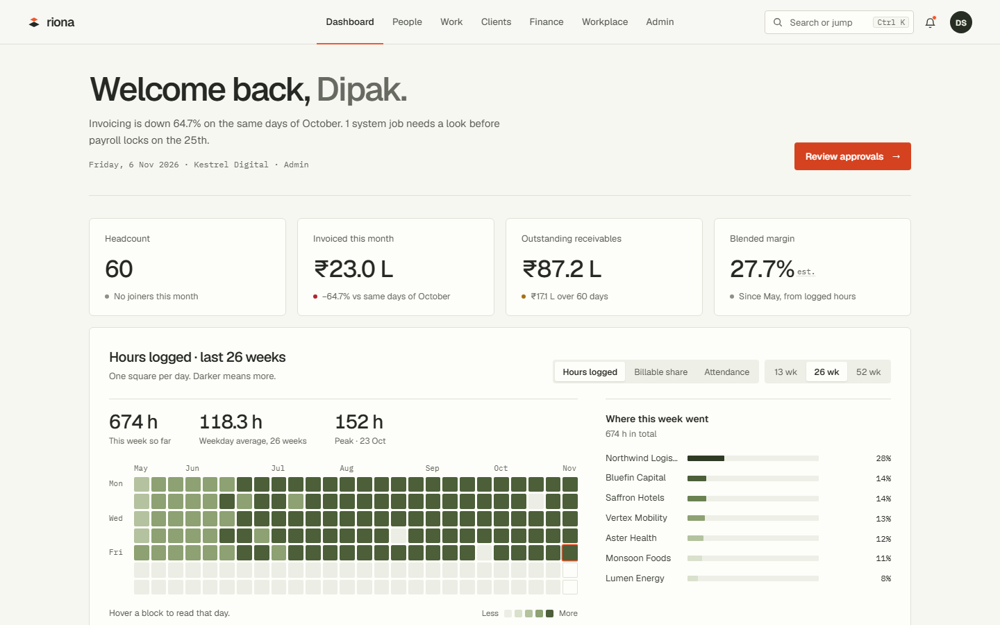 | 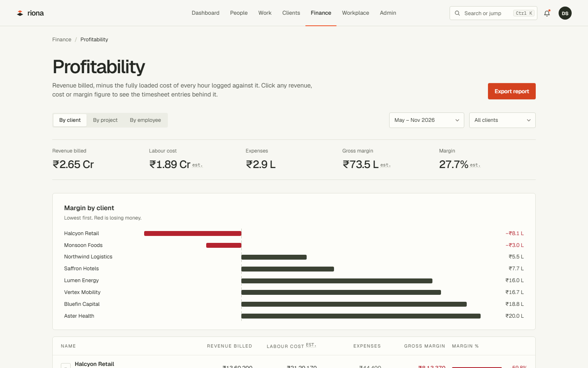 |
| **Salary ledger: "as paid at the time" for July 2026** | **New invoice, built from approved hours** |
| 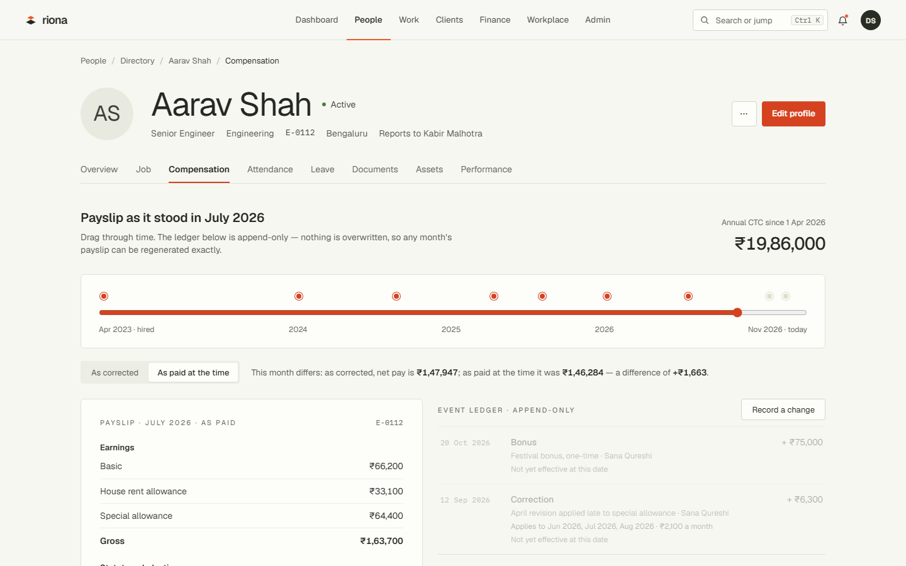 | 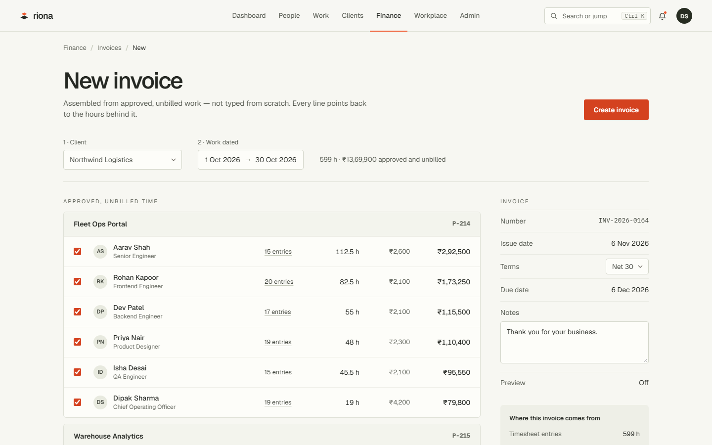 |
| **Approval workflow builder (approver step with its SLA)** | **Approvals queue** |
| 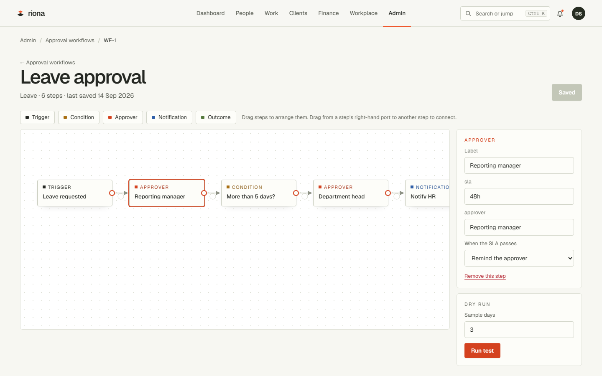 | 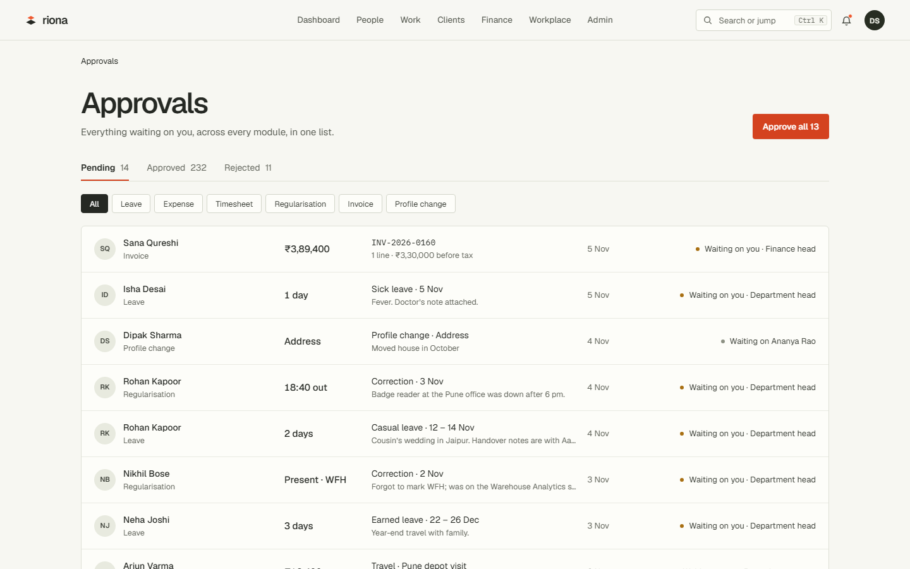 |
| **Weekly timesheet** | **Client portal invoice, GST split, Pay button** |
| 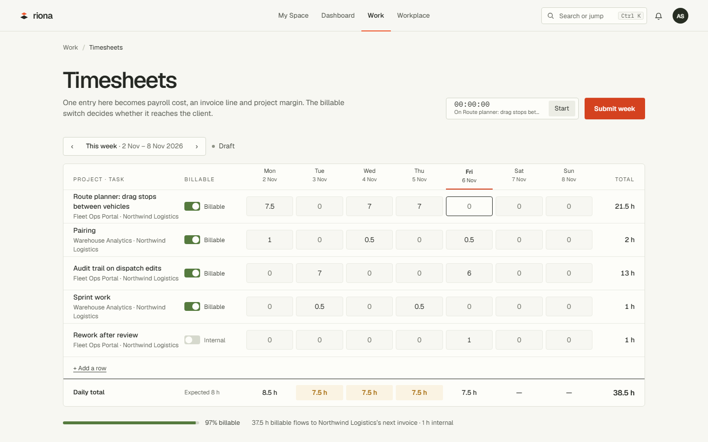 | 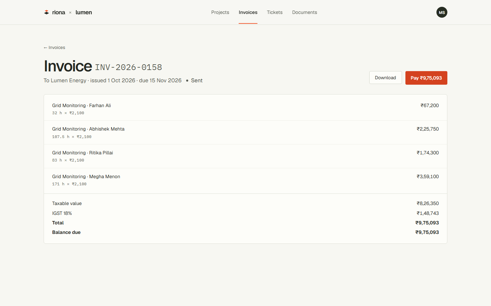 |
| **Employee dashboard: the same route, a different role** | **Audit log, with a change's before and after** |
| 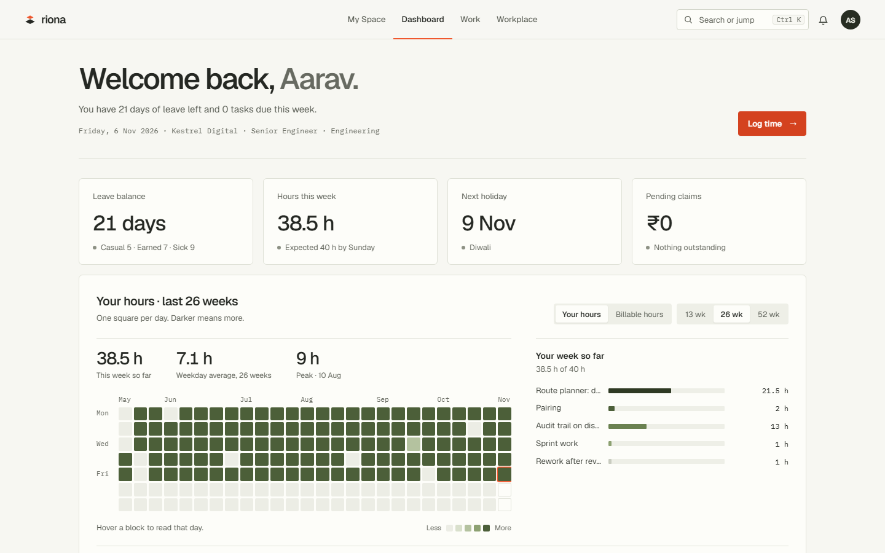 | 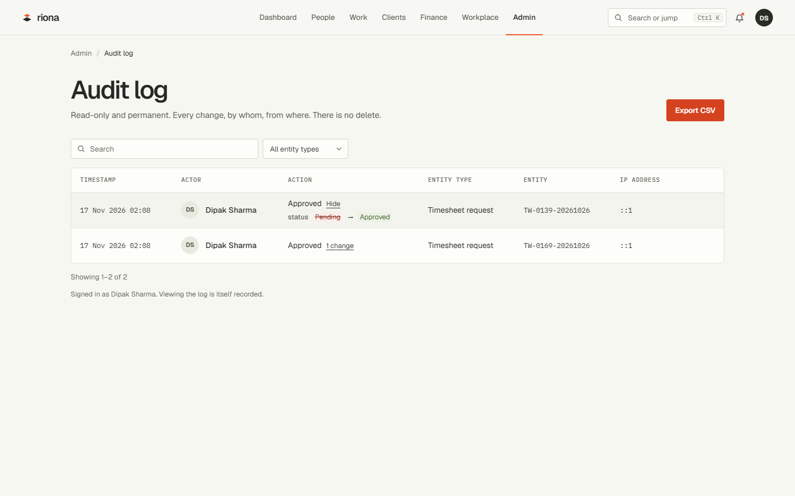 |

On a phone, tables become stacked cards and the timesheet shows one day at a time:

<p>
  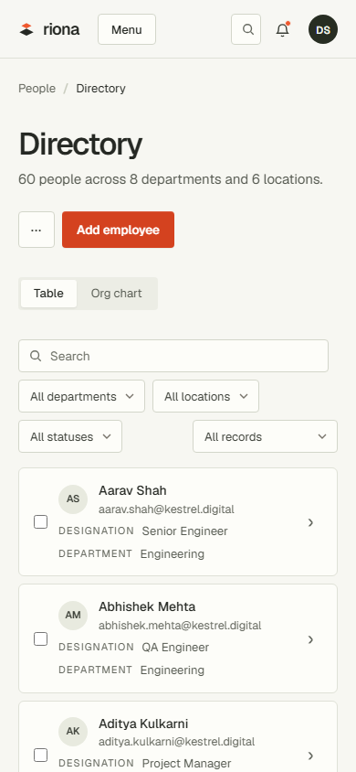
  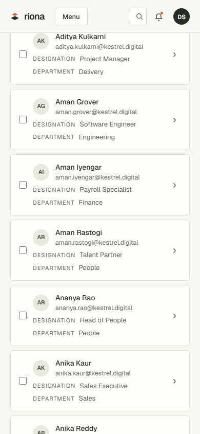
</p>

The full set of 51 screenshots, with every screen described, is in the project report,
[`docs/Riona_Project_Report.pdf`](docs/Riona_Project_Report.pdf).

## Stack

| Part | Built with |
|---|---|
| Frontend (`frontend/app`) | React 18, Vite, TypeScript; a small hash router (128 routes, lazy-loaded per hub) |
| Backend (`backend`) | Node.js 20, Fastify 5, Kysely, Zod, PostgreSQL 16 (15 migrations, 76 tables, row-level security) |
| Shared (`packages/shared`) | Domain types and the error contract both sides use |
| Tests | Vitest (379 backend tests on a real database, 66 frontend), Playwright route gate, axe-core |
| Local services | Docker Compose: PostgreSQL and Mailpit |

The design system (warm paper, olive ink, one signal orange; Geist and IBM Plex Mono) is written up in
[`frontend/app/DESIGN.md`](frontend/app/DESIGN.md).

```
riona/
├── frontend/app/      the web app: public site, sign-in, the app for five roles, the client portal
├── backend/           API: modules per area, engines (approvals, payroll, audit), migrations, demo seed
├── packages/shared/   types and the error contract used by both
└── docs/              project report (PDF and source) and screenshots
```

## First-time setup (Windows cmd)

Needs Node 20.12+ and Docker Desktop (running).

```bat
cd /d D:\riona
copy .env.example .env
copy backend\.env.example backend\.env
copy frontend\app\.env.example frontend\app\.env.local
npm install
npm run db:up
npm run db:seed -w backend
```

`db:seed` resets the development database, applies the migrations and loads the demo data. Run it again any time to
start over (`db:migrate` applies new migrations without touching data).

In `backend\.env`, replace `SESSION_SECRET` with a random value:

```bat
node -e "console.log(require('crypto').randomBytes(48).toString('base64url'))"
```

Postgres from docker-compose listens on **5433**, so it doesn't clash with a locally installed Postgres on 5432.

### Demo accounts

Every demo account uses the password `riona-demo-2026` (demo data only; never reuse it).

| Role | Email | Lands on |
|---|---|---|
| Admin | dipak.sharma@kestrel.digital | Admin dashboard |
| HR | meera.iyer@kestrel.digital | HR dashboard |
| Manager | vikram.menon@kestrel.digital | Manager dashboard |
| Employee | aarav.shah@kestrel.digital | My Space |
| Client (Lumen Energy) | meghna@lumen.in | Client portal |

Every client's primary contact has a portal account (for example rajiv@northwind.in for Northwind). Client accounts
can use only the portal, and staff accounts can't use it. Five wrong passwords lock an account for 15 minutes.

"Continue with Google / Microsoft" works once that provider's client ID and secret are set in `backend\.env`; until
then the button says single sign-on isn't set up. In development the server clock is pinned to the demo data's date
(`CLOCK_FIXED_NOW`), and every email (invitations, password resets) lands in Mailpit.

## Every day

```bat
npm run dev
```

starts both servers in one terminal (or run `npm run dev:backend` and `npm run dev:frontend` separately).

| What | Where |
|---|---|
| App | http://localhost:5173 |
| API | http://localhost:3000/api/v1 (health: `/api/v1/health`) |
| Email inbox (Mailpit) | http://localhost:8025 |
| Postgres | localhost:5433, user, password and database `riona` |

The frontend always talks to the API (browser → Vite proxy → backend); the demo data lives in
`backend/db/seed/demo` and reaches the browser only through the API.

## Checks

```bat
npm run typecheck
npm test
```

Backend tests use a separate database (`riona_test`, created automatically) and need `npm run db:up`. Among them:

- `test/contract/`: every endpoint answers, and answers what the screens expect (recorded answers in
  `test/golden/fixture.json`); the server-computed dashboards equal the screens' own selectors.
- `test/invariants/reconciliation.test.ts`: profitability adds up for every client and project.
- `test/security/`: role scopes, sign-in lockout, single sign-on attacks, and the portal's walls tried through the
  API and raw SQL.

The route gate visits every route as each role at 1440 and 390 px (needs Playwright, and both servers running):

```bat
set GATE_PASSWORD=riona-demo-2026
node frontend\app\scripts\gate.cjs http://localhost:5173 frontend\app\scripts\routes.txt
```

## How it works

**Contracts.** `frontend/app/src/data/repositories/contract.ts` declares the 137 data functions the screens use;
`http/endpoints.ts` maps them to 139 HTTP endpoints, and a test round-trips every one. No screen calls the network
directly. Every failure uses one error body, `{ error: { message, code, fields?, requestId } }`
(`packages/shared/src/errors.ts`).

**Writes.** Every write runs in one transaction helper that also writes the audit entry and queues notifications and
emails in an outbox, delivered after commit. State-changing requests need a custom header (CSRF protection), and
sessions store only a SHA-256 of their token.

**Billing rules the database enforces** (`db/migrations/012_finance_guards.sql`): a timesheet entry can be on only
one live invoice, and only if it is approved, billable and the same client's; billed hours can't change; payments
can't exceed an invoice's total, which is frozen in `invoices.issued_totals` at issue. Cost rates come from the
`entry_costs` view (`db/views/profitability.sql`).

**The client portal's walls** (`db/migrations/011_portal_rls.sql`, `src/http/plugins/portal-scope.ts`): portal reads
run read-only as the Postgres role `riona_portal`, granted only client-safe columns, with row-level security on every
table. The migration creates that role, so the app's database user needs CREATEROLE when migrating (the Docker
database's user has it). Online payments are simulated in development (`PAYMENT_GATEWAY=simulated`); a real gateway
confirms through a signed `POST /api/v1/webhooks/payments`.

**Dashboards** (`GET /dashboard-facts`, `GET /dashboard-blocks`) are computed on the server, over only what the
signed-in person may see.

**Approval SLAs** (`engines/approvals/timeouts.job.ts`, every 15 minutes): when a step's SLA passes, its approver is
reminded once, or the step is approved automatically where the workflow says so.

**Files** (`src/storage/files.ts`): uploads are checked against an allow-list and a size limit (`UPLOAD_MAX_MB`) and
stored under `STORAGE_DIR` (default `backend/var/uploads`); downloads are five-minute links signed with
`SESSION_SECRET`, checked against the stored SHA-256.

**Accounts.** HR adds a person (People › New hire), then an Admin invites them (Admin › Users). The invitation and
"Forgot password" both lead to `#/reset-password/:token`. Deactivating a user ends their sessions at once, and the
last active Admin can't be removed.

## Not built yet

These are on the roadmap, and the app labels them as coming wherever they appear:

- Enforcing edits made in Admin › Roles. The server enforces the matrix in `backend/src/auth/rbac/permissions.ts`.
- Delivery driven by Admin › Notification rules.
- A real payment gateway (only the simulated one exists).
- Multi-factor sign-in, field-level encryption, SAML and SCIM.
- CSV import, statutory e-filing (EPFO ECR, ESIC, PT challans, Form 24Q) and direct bank disbursement.
